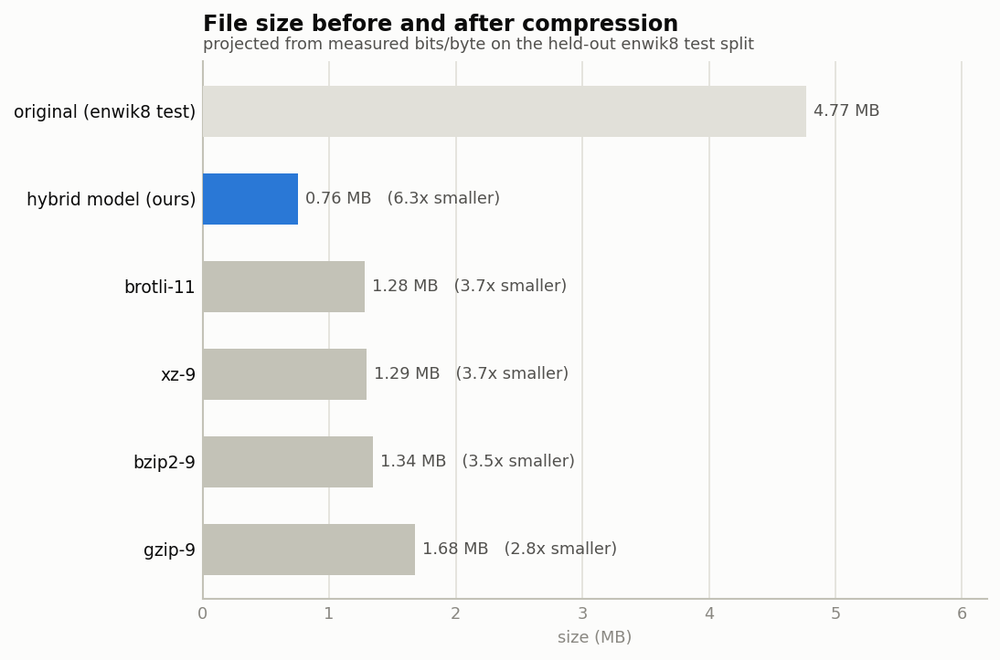
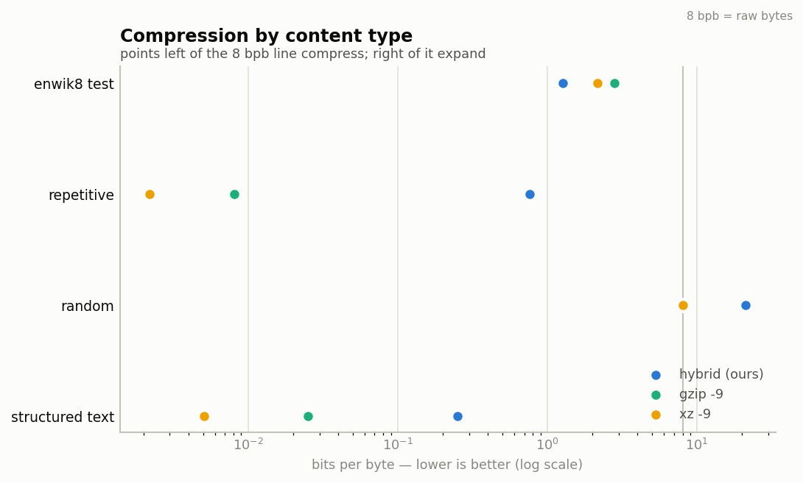
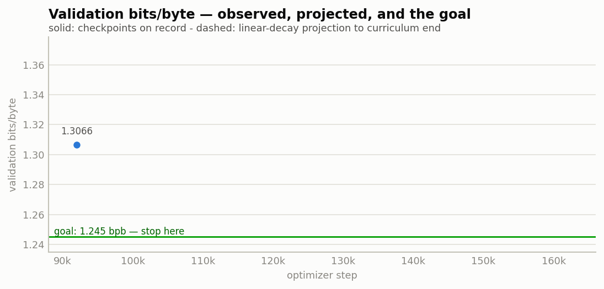
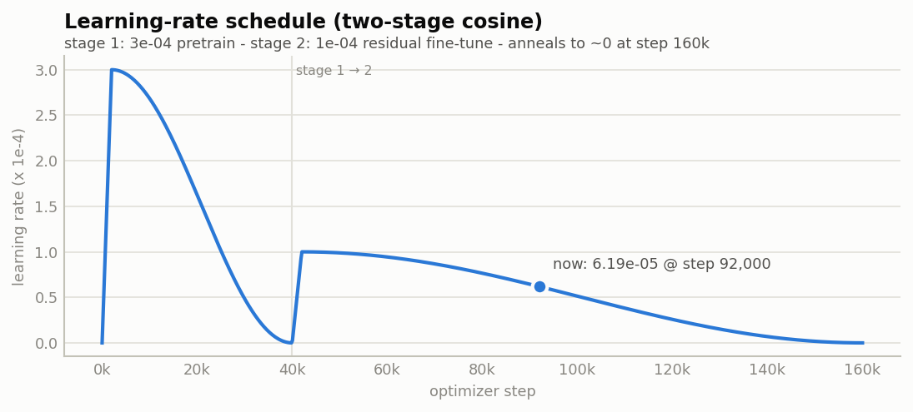

# Enterprise benchmark report

*Generated 2026-07-09 01:46:44 — checkpoint `best.pt` step 92,000 — device cpu*

## A. Compression quality (test split)

| metric | value |
|---|---|
| bits/byte (raw) | 1.2802 |
| bits/byte (calibrated T*=1.107) | 1.2672 |
| perplexity | 16.73 |
| top-1 / top-5 accuracy | 48.68% / 67.36% |
| projected size of 100 MB enwik8 | 15.84 MB |
| eval coverage | 12.5% of test split |

### Before / after (5 MB held-out corpus)

| compressor | size after | ratio | bits/byte |
|---|---|---|---|
| — original | 4.77 MB | 1.00x | 8.0000 |
| **hybrid model (ours)** | **0.76 MB** | **6.31x** | **1.2672** |
| brotli-11 | 1.28 MB | 3.72x | 2.1501 |
| xz-9 | 1.29 MB | 3.68x | 2.1711 |
| bzip2-9 | 1.34 MB | 3.55x | 2.2541 |
| gzip-9 | 1.68 MB | 2.84x | 2.8180 |

## B. Correctness gates

- arithmetic-coder self-test: **PASS**
- model-distribution lossless roundtrip: **PASS** (3.876 bits/token)
- tokenizer byte-exact roundtrip: **PASS**
- streaming reference decoder: **PASS**

## C. Calibration

- optimal temperature T* = 1.1074
- NLL 2.9416 → 2.9206
- ECE 0.0527 → 0.0526

## D. Performance

- parameters: 10.56 M  (checkpoint 377 MB on disk)
- throughput: 4583 tok/s ≈ 0.014 MB/s  (cpu, batched upper bound)
- latency per batch p50/p95: 867 / 1118 ms
- peak RSS: 3.13 GB

## E. Robustness

| case | model bpb | gzip bpb | xz bpb |
|---|---|---|---|
| repetitive | 0.7635 | 0.0081 | 0.0022 |
| random | 21.0997 | 8.0035 | 8.0042 |
| structured_text | 0.2496 | 0.025 | 0.0051 |

## F. Stopping policy

**CONTINUE** — still improving.

- curriculum: step 92,000 / 160,000 (57%)
- goal (calibrated test bpb): 1.245 — not met
- projected final val bpb: None
- projected final calibrated test bpb: None
- goal projected reachable near step: — (curriculum end decides)
- overtraining detected: False

## G. Training state & tuning

| quantity | value |
|---|---|
| optimizer step | 92,000 / 160,000 (stage 2) |
| scheduled LR now | 6.187e-05 |
| LR plan | stage 1: 3e-04 → stage 2: 1e-04, warmup 2,000, cosine → 0 |
| val loss | 3.1024 nats/tok = 4.4758 bits/tok (1.3916 bpb) |
| test loss | 2.8171 nats/tok = 4.0642 bits/tok (1.2802 bpb) |
| stored best val bpb (full split) | 1.3066 |

### Recommendations

1. Finish the curriculum first — 68,000 steps remain (~23 h on a Kaggle T4 at ≈3,000 steps/h, i.e. ~2 more sessions). The cosine schedule continues automatically on resume; the LR is already at 6.19e-05 and anneals to ~0 at step 160,000, which is itself the main protection against late-stage overfitting.
2. Logits are overconfident (T* = 1.107). Keep baking calibration_T into the export — it is worth +0.0130 bpb for free. If a fresh run is ever started, raising dropout 0.1 → 0.15 or weight_decay 0.01 → 0.02 should reduce this overconfidence at the source.
3. Incompressible input EXPANDS badly (random bytes: 21.1 bpb vs 8.0 raw). Add a raw-block escape to the Rust coder: when the running model cost exceeds ~8 bpb over a block, emit literal bytes. Caps the worst case at ≈8.03 bpb without touching the model.
4. Highly repetitive data: classical LZ crushes it (xz 0.0022 vs model 0.7635 bpb). The match expert saturates at conf 0.99 with a smoothed tail; a cheap LZ pre-pass (or letting match_conf reach ~0.999) would close most of that gap.
5. Stopping is AUTOMATIC: run_budget() ends the session chain the moment a phase confirms calibrated test bpb ≤ 1.245 (the statistically projected best-achievable value for this architecture), or at curriculum end (step 160,000), or on a val plateau (< 0.003 bpb per ~30k-step session; trainer patience 8 evals) — whichever happens first. Sessions started after the stop exit immediately.

**Overall: PASS**
